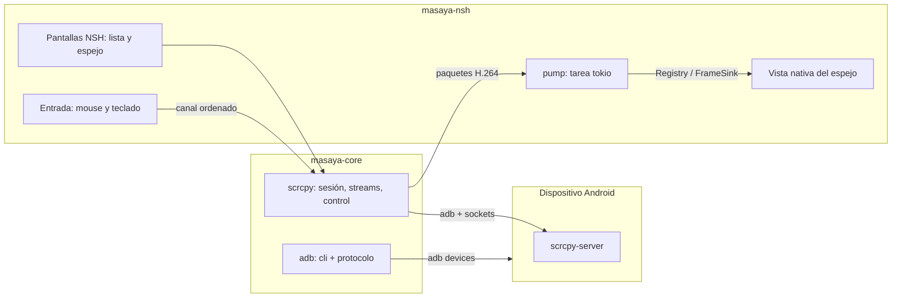

# Arquitectura

Masaya es una app nativa de macOS (14 o superior, Apple Silicon) escrita solo en Rust. La interfaz usa
[NSH](https://crates.io/crates/nsh-core) 0.4.0; el video se decodifica por hardware con VideoToolbox y se
dibuja en un `AVSampleBufferDisplayLayer`, sin pasar por la interfaz. La decisión está en
[ADR-0004](adr/0004-app-nativa-con-nsh.md).

## Vista general

| Crate         | Responsabilidad                                                                          | Compila en      |
| ------------- | ---------------------------------------------------------------------------------------- | --------------- |
| `masaya-core` | Encontrar `adb`, listar dispositivos, protocolo scrcpy (sesión, video, audio, control)   | Cualquier sistema |
| `masaya-nsh`  | Pantallas, vista nativa del espejo, traducir mouse y teclado, H.264 a formato de macOS    | Solo macOS      |

El core no depende de la interfaz, así que CI lo prueba en Linux. En la app, las reglas viven en módulos
puros (`state`, `input`, `mirror::h264`) sin tipos de NSH ni AppKit, y se prueban con tests unitarios; las
pantallas reciben un `DeviceSource`, que en los tests es un falso.

## Flujos

### Listar dispositivos

`DevicesStore` (`store.rs`) pertenece a la ventana, no a la pantalla: ejecuta `adb devices -l` cada 2 s y
`masaya_core::adb::device` convierte la salida en dispositivos. Volver del espejo conserva la lista. La
pantalla (`screens/devices.rs`) muestra carga, vacío, error (con Reintentar) y los teléfonos con su estado y
qué hacer si no se pueden abrir.

`masaya_core::adb::path` busca `adb` en `ADB_PATH`, el SDK de Android (`ANDROID_HOME`, `ANDROID_SDK_ROOT`),
las rutas habituales y el `PATH`.

### Abrir un espejo

1. `screens/mirror.rs` arranca la sesión: `masaya_core::scrcpy::session` sube `scrcpy-server.jar`
   (`mirror::server` lo busca en `MASAYA_SCRCPY_SERVER`, en `Resources` del bundle o en `resources/` del
   repositorio), lo lanza y conecta los sockets.
2. `mirror::pump` corre en un worker de tokio y pasa cada paquete al `Registry` (`mirror::sink`) bajo la clave
   de la sesión. Guarda la última configuración del códec, así una vista que llega tarde puede decodificar.
3. La vista nativa `masaya.mirror` (`macos/mirror_view.rs`) registra su `FrameSink`; `mirror::h264` convierte
   Annex-B en AVCC y la capa lo decodifica y lo dibuja en cuanto llega, manteniendo la proporción.

Un paquete malformado del teléfono es un error, nunca un panic. Aun así, `release` usa `panic = "unwind"` para
que un panic en una tarea no cierre la app.

### Control

`macos/input_view.rs` lee los eventos de AppKit y `input` los traduce a mensajes scrcpy: clic izquierdo es el
dedo, derecho es Atrás y central es Inicio; la rueda y el trackpad se convierten en muescas
(`input::scroll`); `input::mapping` lleva el punto de la vista a la pantalla del teléfono teniendo en cuenta
las bandas del letterbox. El texto pasa por `NSTextInputClient`, así llegan acentos y métodos de entrada.

`mirror::control` envía los mensajes por **un solo canal por sesión** y una tarea los manda de uno en uno,
para que un movimiento posterior no adelante a una pulsación anterior. Al perder el foco se levanta el dedo y
se sueltan las teclas.

## Límites de confianza

Lo que llega del teléfono (video, mensajes del dispositivo) no es de confianza: el core y `mirror::h264`
validan longitudes y formatos y devuelven errores. `masaya_core::scrcpy::validate` comprueba los rangos de
opciones y mensajes de control antes de convertirlos en bytes. `adb` se lanza directamente, sin un shell local de por medio.

## Decisiones

- [ADR 0004 — Reescribir Masaya como app nativa en Rust con NSH](adr/0004-app-nativa-con-nsh.md)
- Historial de la app Electron, ya reemplazada: [ADR 0001](adr/0001-video-por-messageport.md),
  [ADR 0002](adr/0002-validacion-ipc.md) y [ADR 0003](adr/0003-migracion-a-tauri.md).
