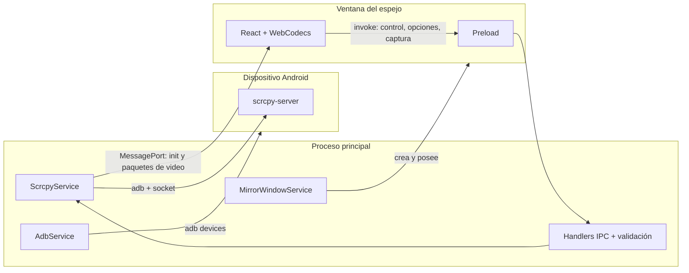

# Arquitectura

Manolo Mirror es una app Electron con tres procesos de código. El video nunca pasa por el proceso de
interfaz principal: viaja por un canal dedicado y se decodifica en la ventana del espejo.

## Vista general

| Proceso   | Responsabilidad                                                                                         | Código         |
| --------- | ------------------------------------------------------------------------------------------------------- | -------------- |
| Principal | Encontrar `adb`, listar dispositivos, abrir sesiones scrcpy, crear ventanas, menú, diálogos de guardado | `src/main`     |
| Preload   | Exponer a cada ventana solo su parte de la API                                                          | `src/preload`  |
| Renderer  | Lista de dispositivos y ventana del espejo                                                              | `src/renderer` |

`src/shared` contiene lo único que ven los tres: contratos IPC (`*.contract.ts`), el tipo `Result` y los
tipos del espejo.

## Flujos

### Listar dispositivos

`DeviceList` → `useDevices` → `listDevices` (IPC) → `AdbService` ejecuta `adb devices -l` y
`parseAdbDevicesOutput` lo convierte en `AndroidDevice[]`. La lista se refresca al enfocar la ventana, cada
5 s y con ⌘/Ctrl+R.

### Encontrar adb y conectar por Wi-Fi

`AdbService` busca `adb` en este orden: el que el usuario eligió en la app (guardado en
`settings.json`), `ADB_PATH`, el SDK de Android, el `PATH` y las rutas habituales. Si no hay ninguno, el
error `ADB_NOT_FOUND_MESSAGE` hace que `App` muestre `AdbSetupPanel` (descargar, elegir o reintentar). Elegir
un archivo lo valida con `adb version` antes de guardarlo.

`WifiConnectDialog` llama a `pairWifi` / `connectWifi` / `disconnectDevice`. `setup.handlers.ts` valida la
dirección (`parseWifiAddress`), rechaza a las ventanas del espejo y ejecuta `adb pair|connect|disconnect`
sin shell. adb informa de muchos fallos con código 0, por eso `AdbService` lee el texto de respuesta.

### Preferencias

`PreferencesService` guarda `settings.json` en la carpeta de datos del usuario: calidad del espejo, ruta de
`adb` y última carpeta de capturas. Se lee una vez al arrancar; un archivo corrupto o con valores
desconocidos se sustituye por los valores por defecto. El renderer solo ve la calidad (`preferences:get|set`).

### Abrir un espejo

1. La lista pide `openMirrorWindow`; `MirrorWindowService` crea una ventana por dispositivo.
2. La ventana pide `openMirror`; `ScrcpyService` sube `scrcpy-server`, arranca el cliente y crea un
   `MessageChannelMain`. Un extremo viaja a la ventana (`mirror:port`).
3. `MirrorStreamSession` envía `init` con el códec y el tamaño, y después cada paquete de video.
4. El renderer mete los paquetes en una **cola acotada** (`packet-queue.ts`) y un `WebCodecsVideoDecoder`
   los dibuja en un `<canvas>`. Si el decodificador va lento, se descartan cuadros hasta el siguiente
   keyframe para que la latencia no crezca.

### Control

`useMirrorInput` traduce eventos del navegador en mensajes (`touch`, `scroll`, `key`, `text`). Los
movimientos se agrupan por puntero y por cuadro de animación (`control-coalescer.ts`). En el proceso
principal, `parseControlMessage` los valida y `ScrcpyService` los ejecuta **de uno en uno por
dispositivo**, para que no se reordenen.

### Teclas del dispositivo e instalar APK

Los botones Atrás, Inicio, Recientes, volumen y encendido envían una pulsación (`key` abajo y arriba) por el
mismo canal de control (`useDeviceKeys`). Instalar un APK (`installApk`, solo desde la ventana dueña del
dispositivo) llega por el selector de archivos o arrastrando un `.apk` a la ventana; el preload traduce el
`File` a una ruta con `webUtils.getPathForFile`. El proceso principal exige ruta absoluta, extensión `.apk` y
archivo existente, y ejecuta `adb -s <id> install -r -t`.

### Cambiar la calidad

`setMirrorOptions` cierra la sesión **sin avisar a la ventana** (`notifyRenderer: false`) y abre otra con
las nuevas opciones. La calidad elegida se guarda como preferencia y la usan las ventanas nuevas. La ventana recibe un puerto nuevo y reinicia el decodificador. Si avisara del cierre,
la ventana se cerraría sola.

## Límites de confianza

El renderer no es de confianza. Cada canal IPC:

1. valida el identificador de dispositivo (`parseDeviceId`);
2. comprueba que quien llama sea la ventana dueña de ese dispositivo (`handleOwnedDevice`);
3. valida el resto del mensaje con reglas numéricas explícitas (`parseNumericFields`): los campos
   obligatorios deben existir y estar dentro de rango.

Además, cada ventana recibe una API recortada (`exposeOnly` en `manolo.api.ts`): la ventana principal
no puede enviar control y la del espejo no puede listar dispositivos ni cambiar `adb`. Las acciones de
configuración (`setup.handlers.ts`) también rechazan a las ventanas del espejo en el proceso principal.

## Decisiones

- [ADR 0001 — El video viaja por MessagePort y se decodifica en la ventana](adr/0001-video-por-messageport.md)
- [ADR 0002 — Contratos IPC con validación en el proceso principal](adr/0002-validacion-ipc.md)

La deuda técnica conocida está en [TECH_DEBT.md](TECH_DEBT.md).
